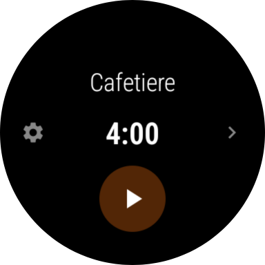
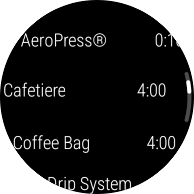
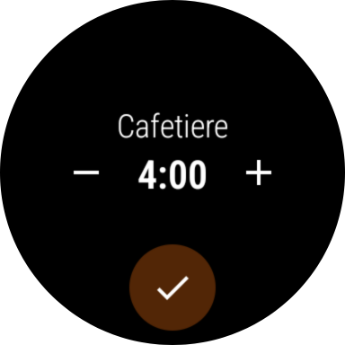
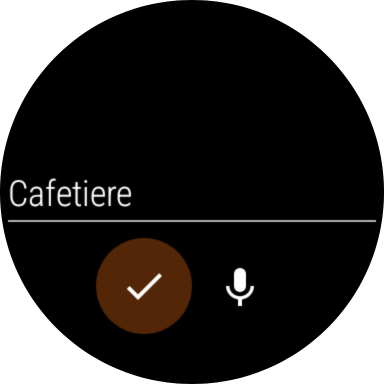
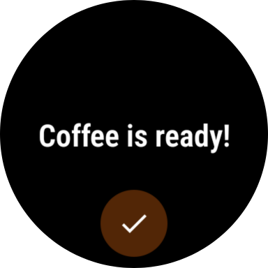

# Mocha

Mocha is a coffee brewing timer for Wear OS™ smartwatches. Choose how you're brewing, start the countdown, and
your watch tells you when your coffee is ready.


## Features

- **Brewing methods.** Comes with a set of common methods, each with a typical brew time: AeroPress, coffee
  bag, drip system, espresso, French press and percolator. Tap the method name to choose a different one.
- **Your own methods.** Long-press the method name, or tap its menu button, to add a method, rename the current
  one, or delete it. Names can be typed or spoken, and must be unique.
- **Adjustable brew times.** Tap the time to change it. The buttons step by 10 seconds, and a long press moves to
  the next or previous whole minute. Brew times can be up to 99:59.
- **Alarm.** When the time is up the watch sounds an alarm and/or vibrates, as chosen in settings. Do Not
  Disturb settings are respected.
- **Works in the background.** The countdown continues when you leave the app. It shows as an ongoing activity
  icon on the watch face and in the app launcher's Recents section, and the alarm is delivered as a
  notification that opens the app.
- **Languages.** English, plus Dutch, French, German, Greek, Italian, Polish, Portuguese (European and
  Brazilian), Spanish, Turkish and Ukrainian.


## Screenshots

| Screen | Description |
|---|---|
|  | **Ready to brew.** The main screen shows the current method and its brew time. Tap the start button to begin the countdown. Tap the method name to switch methods, or the time to change it. The arrow opens the menu for adding, renaming and deleting methods, and the gear opens the settings. |
|  | **Choosing a method.** Scroll through your methods, listed alphabetically with their brew times, and tap one to select it. |
|  | **Setting the brew time.** The minus and plus buttons adjust the time in 10-second steps; long-press them to jump to the previous or next whole minute. Tap the tick to save. |
|  | **Naming a method.** Type a name, or tap the microphone and say it. Each method needs its own name. |
|  | **Coffee's ready.** When the time is up, the watch shows this screen and sounds the alarm and/or vibrates, as set in the settings. Tap the tick to stop the alarm. |


## Requirements

- A watch running Wear OS 3 or later (Android API level 30 or later).
- To build: the .NET 10 SDK with the Android workload, or Visual Studio with .NET Android support.

Mocha is not published on the Google Play Store. To use it, build it and install it on your watch yourself.


## Building

```bash
dotnet workload install android
dotnet build Mocha.App/Mocha.App.csproj -c Release
```

Or open `Mocha.sln` in Visual Studio.

Release builds include 32-bit ARM, 64-bit ARM and x86-64 code, covering current watches and emulators. Debug
builds also include 32-bit x86, for the Wear OS 3 emulator.

The `lib` folder contains prebuilt copies of the `Kilsten.Android` and `Kilsten.WearOS` helper libraries that
the app uses. Their source is at <https://github.com/andyjohnson0/Kilsten>.


## Installing

Enable developer options and wireless debugging on the watch, connect to it with `adb`, then install the APK
produced by the build:

```bash
adb install Mocha.App/bin/Release/net10.0-android36.0/uk.andyjohnson.Mocha-Signed.apk
```

## Permissions

| Permission | Why it's needed |
|---|---|
| Notifications | To tell you your coffee is ready when the app is in the background. |
| Alarms and reminders (exact alarms) | To sound the alarm at exactly the right time. |
| Vibrate | To vibrate when the alarm goes off. |
| Microphone | Only for speaking method names. |
| Wake lock, foreground service | To wake the watch and sound the alarm when the app is in the background. |


## License

Mocha is licensed under the MIT License. See [LICENSE.md](LICENSE.md).

Android and Wear OS are trademarks of Google LLC. This project is not associated with or endorsed by Google LLC.

The coffee cup app icon is by Konstantin Filatov, from [SVG Repo](https://www.svgrepo.com/svg/521575/coffee),
and is licensed under the [CC Attribution License](https://www.svgrepo.com/page/licensing/#CC%20Attribution).
Many thanks to Konstantin for making it available.


## Author

Andrew Johnson - [andy@andyjohnson.uk](mailto:andy@andyjohnson.uk) - [https://andyjohnson.uk](https://andyjohnson.uk)


## AI Statement

This code was written by the author, who is Human, in2024. A coding agent (Claude Code) was briefly used,
in 2026, to perform some mechanical refactoring and documentation updates and to fix a few known bugs.
The author reviewed and approved all changes. The functional code is human-written.
